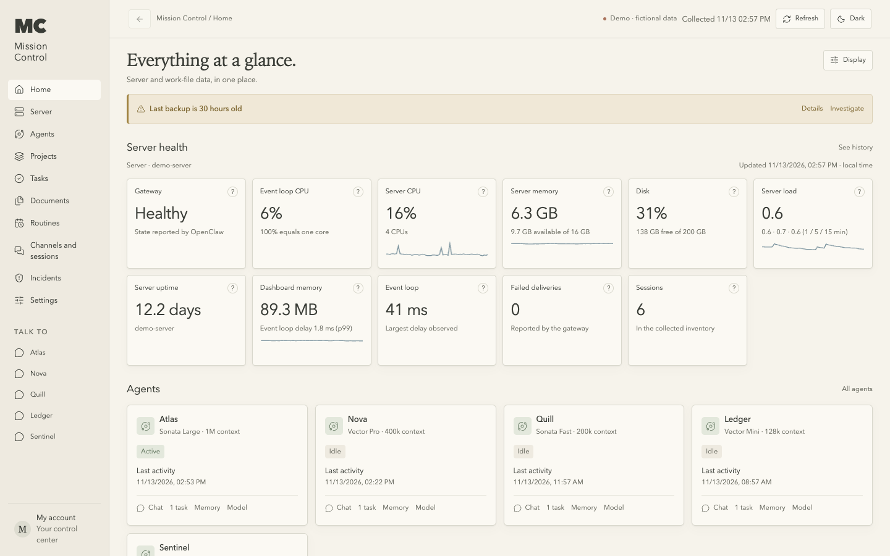
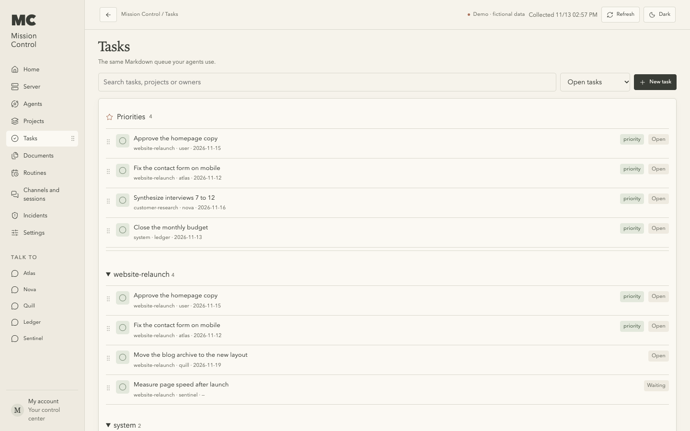
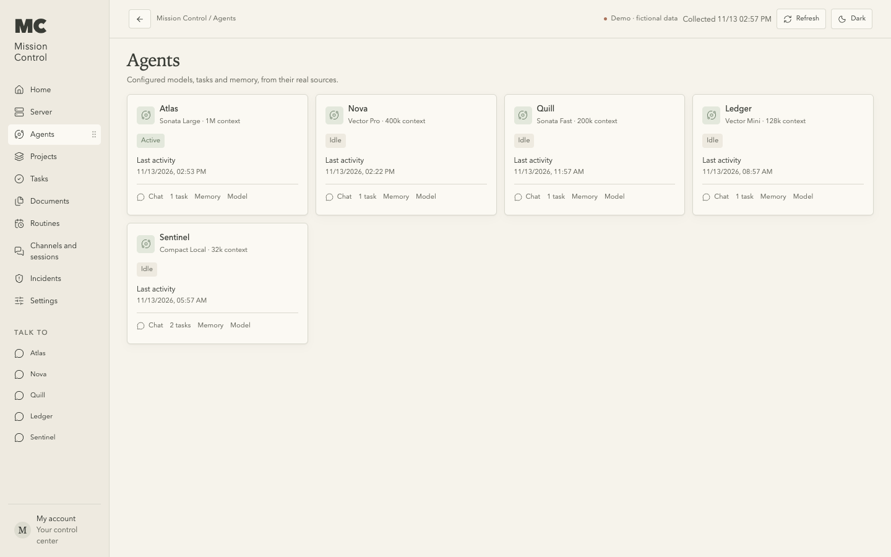
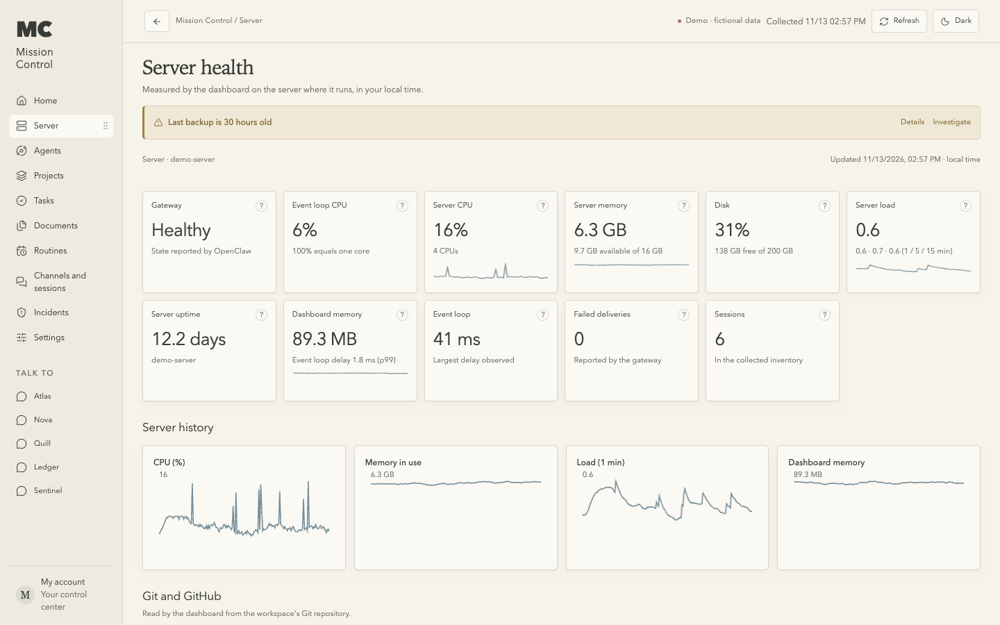

# Mission Control for OpenClaw

A self-hosted dashboard to follow and steer your OpenClaw agents: agents, chat,
routines, sessions, models, server health and, if you keep one, the tasks and
documents of your Markdown workspace, all on one page. Light and dark themes,
English and Portuguese.



| Tasks | Agents | Server |
|---|---|---|
|  |  |  |

## Features

- **Agents and chat:** every agent with its model, fallbacks, activity and sessions;
  chat with any of them, attach files, read the history, change models.
- **Routines, channels and sessions:** see and edit schedules, follow runs, check
  channel health, renew a session after reviewing it.
- **Server health:** CPU, memory, disk and load of the machine the dashboard runs on,
  Gateway health, and optional health checks from your own jobs that become alerts
  and incidents.
- **Tasks, projects and documents** (optional): read from a Markdown/Git workspace in
  English or Portuguese; edits, priorities and new tasks are Git commits with an
  audit trail. Documents open in an editor and export to PDF, Word or Markdown.

## Try the demo

No OpenClaw needed; everything is fictional and read-only.

```bash
npm ci --ignore-scripts
npm run demo
```

Open http://127.0.0.1:4319.

## Run it with your OpenClaw

With Docker Compose:

```bash
cp .env.example .env     # set MC_ACCESS_TOKEN (openssl rand -hex 32) and MC_GATEWAY_TOKEN
docker compose up -d --build
```

Open http://127.0.0.1:4318 and sign in with your access token. The first time, the
dashboard asks your Gateway to pair its device: Home shows the command to approve it,
such as `openclaw devices approve <requestId>`.

Without Docker (Node.js 24.19 or later), on the machine you browse from:

```bash
npm ci --omit=dev --ignore-scripts
MC_GATEWAY_URL=ws://127.0.0.1:18789 MC_GATEWAY_TOKEN=... npm start
```

[docs/INSTALL.md](docs/INSTALL.md) covers reaching a Gateway on another machine,
every setting, backups and recovery.

## Sign-in

| `MC_AUTH` | For |
|---|---|
| `none` | Only you, on this computer (default for `npm start` on 127.0.0.1). |
| `token` | Anyone else can reach it (default in Docker). One access token, then a browser session. |
| `proxy` | A reverse proxy already signs people in: Tailscale Serve, oauth2-proxy, Authelia... |
| `cloudflare-access` | Cloudflare Access in front, with its token verified again by the dashboard. |

To use it from other devices, put an HTTPS reverse proxy in front; see
[docs/INSTALL.md](docs/INSTALL.md#3-sign-in).

## Make it yours

- **Workspace:** set `MC_WORKSPACE` (`MC_WORKSPACE_DIR` in Docker) to your Markdown/Git
  folder to see tasks, projects and documents. Folders and fields can be in English or
  Portuguese: [docs/WORKSPACE.md](docs/WORKSPACE.md).
- **Branding and language:** `public/brand.js` sets initials, name, subtitle and the
  default language; each viewer can switch language in Settings.
- **Your copy:** click **Use this template** on GitHub to start your own repository.

> **Em português:** a interface também está em português. Escolha em Settings →
> Language, ou defina `language: 'pt'` em `public/brand.js`.

## More

- [docs/INSTALL.md](docs/INSTALL.md): installation, settings, health checks, recovery
- [docs/OPENCLAW.md](docs/OPENCLAW.md): how it connects to OpenClaw and what it calls
- [docs/WORKSPACE.md](docs/WORKSPACE.md): workspace format
- [docs/SECURITY.md](docs/SECURITY.md): security notes
- [docs/FOR-YOUR-AI.md](docs/FOR-YOUR-AI.md): a briefing for an AI that installs it for you

Built against OpenClaw 2026.9.x. Run the tests with `npm test`.

## License

Free for personal and internal use, including inside companies. Selling it, offering
it as a hosted service, or charging others to deploy or run it requires a prior
commercial agreement: see [LICENSE](LICENSE) and [COMMERCIAL.md](COMMERCIAL.md).
Third-party notices: [THIRD_PARTY_NOTICES.md](THIRD_PARTY_NOTICES.md).
